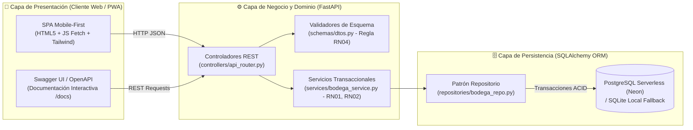
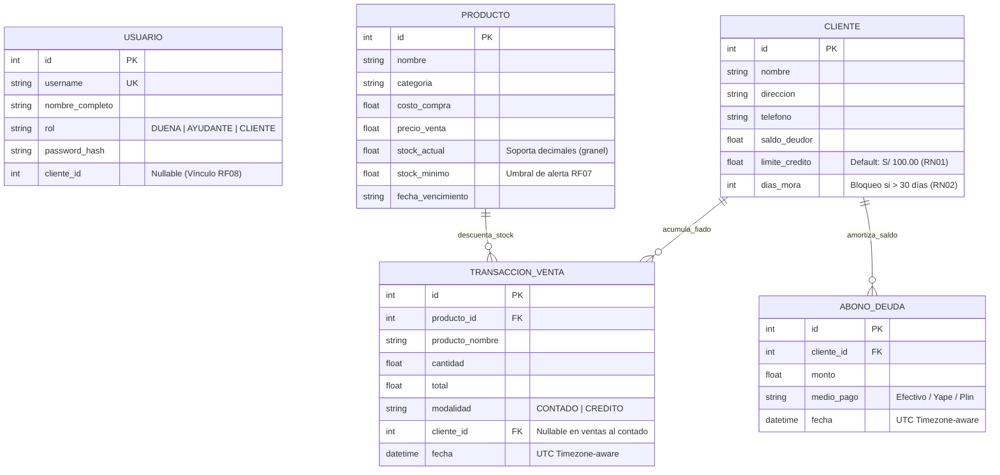

<div align="center">

# 🛒 BodegaControl — Sistema POS Móvil, Inventario y Control de Créditos

**Plataforma Web Responsiva (PWA) con Arquitectura en 3 Capas para Gestión Comercial de Bodegas Minoristas**

[](https://www.python.org/)
[](https://fastapi.tiangolo.com/)
[](https://www.sqlalchemy.org/)
[](https://docs.pydantic.dev/)
[](https://neon.tech/)
[](https://tailwindcss.com/)
[-2EA44F?style=for-the-badge&logo=pytest&logoColor=white)](#6-suite-de-pruebas-automatizadas-pytest)

---

**Versión:** `v1.0.0` · **Patrón Arquitectónico:** `Monolito Modular en 3 Capas` · **Especificación API:** `OpenAPI 3.1 / Swagger`

</div>

---

## 📋 1. Descripción Técnica del Sistema

**BodegaControl** es un sistema de punto de venta (POS), control de existencias y administración de carteras de crédito minorista ("fiados") diseñado bajo un enfoque **Mobile-First**[cite: 63, 70]. Resuelve los tres cuellos de botella críticos del comercio minorista tradicional[cite: 63]:

1. **Agilidad Transaccional en Mostrador (`RNF01`):** Interfaz ergonómica optimizada para operación táctil con una sola mano, permitiendo liquidar ventas al contado o a crédito en **$\le 10$ segundos**[cite: 63, 70].
2. **Integridad de Inventario y Venta a Granel (`RF02`, `RF03`, `RF07`):** Soporte nativo de coma flotante para despacho fraccionado al peso (ej. `0.25 kg`, `0.50 kg`) con descuento atómico de stock y emisión automática de alertas tempranas ante umbrales críticos de reposición[cite: 63, 67, 73, 77].
3. **Control Automatizado de Riesgo Crediticio (`RN01`, `RN02`):** Motor de reglas de negocio en capa de servicio que audita en tiempo real la antigüedad de deuda y el cupo disponible por cliente antes de comprometer una transacción[cite: 73].

---

## 🏗️ 2. Arquitectura del Software y Diseño en Capas

El sistema implementa una arquitectura de **Monolito Modular en 3 Capas Lógicas**, aplicando estrictamente los principios **SOLID**, **DRY** (*Don't Repeat Yourself*) y **KISS** (*Keep It Simple, Stupid*) para desacoplar la presentación web, las validaciones de dominio y la persistencia relacional[cite: 63, 75]:



### Estructura de Módulos del Proyecto

```text
BodegaControl/
├── app/
│   ├── core/
│   │   ├── config.py          # Gestión de variables de entorno (.env) y constantes de negocio
│   │   └── database.py        # Configuración del motor SQLAlchemy e inyección de sesiones DB
│   ├── models/
│   │   └── entities.py        # Modelos relacionales ORM (Usuario, Producto, Cliente, Venta, Abono)
│   ├── schemas/
│   │   └── dtos.py            # DTOs Pydantic v2 y validadores de campo (@field_validator RN04)
│   ├── repositories/
│   │   └── bodega_repo.py     # Capa de acceso a datos aislada (Consultas ORM puras)
│   ├── services/
│   │   └── bodega_service.py  # Lógica de dominio, reglas de crédito (RN01/RN02) y atomicidad ACID
│   ├── controllers/
│   │   └── api_router.py      # Enrutador RESTful estructurado en los 7 módulos del sistema (M1-M7)
│   ├── static/
│   │   └── index.html         # Interfaz gráfica responsiva (Paleta Slate & Indigo)
│   └── main.py                # Punto de entrada ASGI, montaje estático e inicialización de semilla
├── tests/
│   └── test_bodega.py         # Suite de pruebas unitarias, integración y Corner Cases (Pytest)
├── pytest.ini                 # Configuración de PYTHONPATH y filtros de ejecución de pruebas
├── .env.example               # Plantilla de configuración libre de secretos (Cumple RNF04)
├── .gitignore                 # Exclusión de artefactos locales, entornos virtuales y archivos .env
└── requirements.txt           # Declaración determinista de dependencias del servidor
```

---

## 🗄️ 3. Modelo de Datos Relacional (ERD)

La persistencia está normalizada en 5 entidades principales gestionadas mediante **SQLAlchemy 2.0**, garantizando atomicidad, consistencia, aislamiento y durabilidad (**ACID — `RNF02`**) en cada operación de caja[cite: 63, 73, 79]:



---

## 🔌 4. Especificación de Módulos y Endpoints REST (`M1` – `M7`)

La API RESTful organiza sus rutas bajo el prefijo `/api` y genera documentación automática en `/docs`[cite: 63, 71]:

| Módulo del Sistema | Método y Endpoint | Requisito Asociado | Descripción Técnica |
| :--- | :--- | :---: | :--- |
| **M1: Usuarios y Roles** | `POST /api/auth/login` | `RF01` / `RNF04` | Valida credenciales y retorna el perfil de acceso (`DUENA`, `AYUDANTE`, `CLIENTE`)[cite: 71, 79]. |
| **M2: Inventario y Alertas** | `GET /api/productos` | `RF02` / `RF07` | Lista el catálogo calculando en tiempo real el flag booleano `alerta_stock_critico`[cite: 71]. |
| **M2: Inventario y Alertas** | `POST /api/productos` | `RF02` / `RN04` | Registra nuevos productos validando que el precio supere al menos en 20% al costo[cite: 71, 77]. |
| **M3: Ventas Mostrador** | `POST /api/ventas` | `RF03` / `RF04` | Ejecuta ventas al contado o crédito de forma atómica, verificando `RN01` y `RN02`[cite: 71, 73]. |
| **M4: Deudas y Padrón** | `GET /api/clientes` | `RF08` / `RF10` | Obtiene el padrón de clientes, su deuda acumulada, tope crediticio y días de mora[cite: 71, 79]. |
| **M4: Deudas y Padrón** | `GET /api/clientes/{id}/estado-cuenta` | `RF08` | Devuelve el detalle de deuda, porcentaje de cupo usado e historial de amortizaciones[cite: 71]. |
| **M5: Envíos Proveedor** | `POST /api/envios` | `RF06
